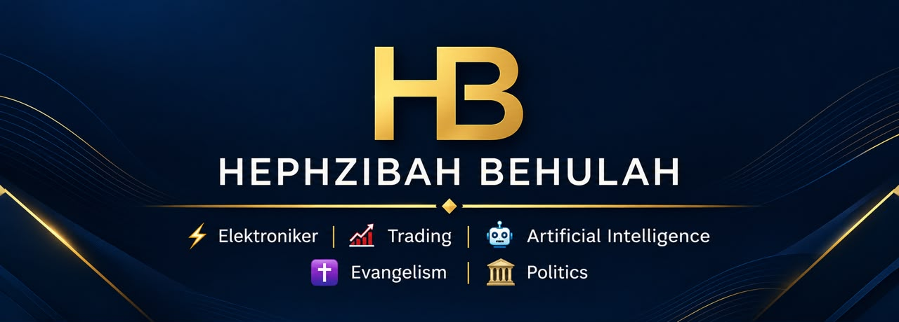
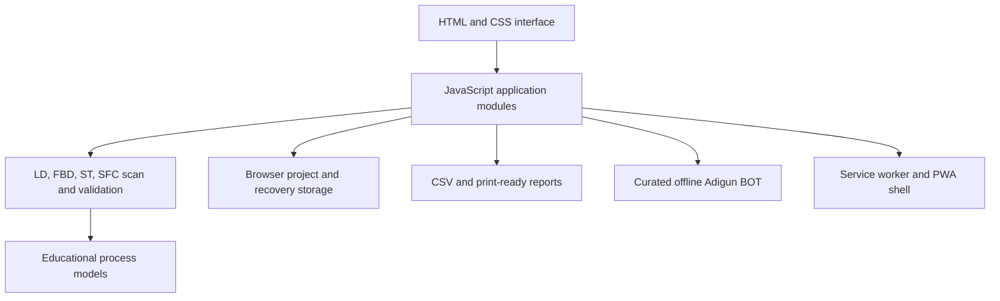

<p align="center">
  
</p>

<h1 align="center">AdigunSPs</h1>

<p align="center"><strong>By HB Elektroniker | A division of HEPHZIBAH BEHULAH</strong></p>

AdigunSPs is an offline-first, browser-based PLC programming learning and simulation application. It provides an editable ladder workspace, educational subsets of FBD, Structured Text and SFC, deterministic scan simulation, project validation, and local project tools for students, automation technicians, electrical engineers, and PLC programmers.

AdigunSPs is an educational simulator. It does not connect to physical PLC hardware and is not a certified safety or engineering system.

## Contents

- [Overview](#overview)
- [Features](#features)
- [Screenshots and preview](#screenshots-and-preview)
- [Technology and architecture](#technology-and-architecture)
- [Requirements](#requirements)
- [Run locally](#run-locally)
- [Build and tests](#build-and-tests)
- [Hosted Adigun BOT setup](docs/ADIGUN-AI-SETUP.md)
- [Deployment](#deployment)
- [Security and safety](#security-and-safety)
- [Known limitations and future work](#known-limitations-and-future-work)
- [Contributing](#contributing)
- [License and ownership](#license-and-ownership)
- [Corporate links](#corporate-links)

## Overview

AdigunSPs offers a local workspace for learning PLC logic and exploring how supported programs behave over simulated scans. Projects are stored in the current browser profile. The application can be installed as a Progressive Web App (PWA) when served from localhost or HTTPS, and its cached shell supports offline use after it has been loaded.

The application is designed for learning and early logic exploration. It does not download programs to controllers, certify logic, select hardware, or replace a vendor programming environment.

## Features

### PLC editors and simulation

- **Ladder Diagram (LD):** edit series contacts and parallel branches; use NO, NC, rising-edge, and falling-edge contacts; normal, SET, and RESET coils; TON/TOF/TP/RTO; CTU/CTD; energized-rung RES; a non-nested MCR section; and linear SCALE in the documented subset.
- **Function Block Diagram (FBD):** use AND/OR (2–8 inputs), NAND/NOR/XOR/XNOR, NOT, TON/TOF/TP/RTO, CTU/CTD, edge blocks, ADD/SUB/MUL/DIV, GT/LT/EQ, and SCALE. The validator reports supported missing-input, type, duplicate-output, and dependency-cycle errors.
- **Structured Text (ST):** compile and scan a subset with semicolon-separated or multiline statements, nested IF/ELSIF/ELSE, named PROGRAM declarations with retained private locals and source-ordered cyclic execution, reusable scalar FUNCTION declarations with positional inputs/private locals, bounded calls, source-located diagnostics, Boolean operators, numeric arithmetic and comparisons, MOD, and parentheses. Compilation uses a module worker when available and a synchronous fallback otherwise.
- **Sequential Function Chart (SFC):** edit steps, transitions, conditions, and actions in a Boolean sequential subset.
- **Scan controls:** run, pause, step, reset, view energized ladder paths, inject supported simulated I/O faults, set breakpoints, replay recorded inputs, and inspect bounded scan history.
- **Scenarios and examples:** run typed input sequences against expected outputs. The learning library contains exactly 1,000 generated, scenario-specific projects in six categories; each has 10–15 LD rungs, localized scenario notes, I/O, and How to test instructions. All 1,000 pass the recorded logic, project-model round-trip, schematic, and supported PLC-to-component validation suite; these remain educational examples, not vendor-validated programs.
- **Electrical schematic workspace:** use 45 generic simulation models covering PLC/I/O modules, pushbuttons, maintained switches, sensors, contactors and auxiliaries, protection contacts, lamps, buzzer, heater, solenoid, motors, supplies, neutral/common, terminals, junctions, and PE symbols. Place, move, rotate, duplicate, edit properties and I/O mappings, and connect terminals. Automatically generated references remain unique across component types that share a prefix. Saved diagrams are part of the project. A contactor's A1/A2 coil circuit drives its main and auxiliary contacts; a wired three-phase starter can switch the educational motor on/off model. See [`docs/COMPONENTS.md`](docs/COMPONENTS.md) for the complete list and model limits.
- **Electrical example checks:** all 1,000 examples include generic PLC schematics using supported catalog models. The latest report records 4,717 PLC logic cases, 8,913 schematic checks, and 4,517 integrated PLC-to-component cases. Analog signal paths carry tag values only; voltage/current physics, manufacturer compatibility, physical wiring, and safety are not certified.
- **Validation boundaries:** the latest report requires every documented example case to reach and pass a supported connected output. It records mapped digital/analog I/O totals and required-terminal warnings; unmapped I/O channels and unused junction/distribution taps do not count as floating faults. Warning totals are not a wiring or safety certification.
- **Manufacturer product reference:** the electrical Components workspace includes a searchable, source-linked catalog of 519 distinct product references. These manufacturer entries are informational and do not claim hardware simulation support. Source limits and the boundary between manufacturer references and executable simulation models are documented in [`docs/industrial-catalog.md`](docs/industrial-catalog.md); the executable simulation library remains generic and educational.

### Projects and engineering tools

- Create, open, rename, duplicate, save, autosave, import, and export browser-local projects; maintain recovery snapshots.
- Manage BOOL, INT, REAL, and TIME tags, roles, aliases, addresses, initial values, and simulated I/O.
- Convert supported simple LD networks to FBD with declared intermediate tags. PLCopen TC6 XML import/export supports series contacts and parallel OR paths with NO/NC contacts and normal coils; timers, counters, edge/set/reset coils, and other editor languages are rejected instead of silently discarded.
- Design multiple local HMI screens with simulated tag-bound controls, values, trends, alarms, recipes, and deterministic educational process models. The 2D process mimic is schematic, not engineering geometry.
- Export I/O schedules, user-entered hardware inventories/BOMs, trend history, and simulation reports as CSV or print-ready HTML that can be saved as PDF through the browser's print dialog. Wiring worksheets and panel references contain user-entered data; they do not determine ratings or certify a design.
- Use the offline Modbus TCP frame tool to inspect supported request/response frames and exceptions. It does not open a network connection or communicate with a PLC.
- Use Adigun BOT for curated PLC explanations, deterministic drafts for supported FBD gate networks, TON delayed lamps, and LD start/stop motors, plus an opt-in live co-pilot that flags selected logic and wiring issues. Co-pilot fixes are limited to adding a simulated BOOL input to an incomplete AND/OR gate and require review before import. Optional hosted answers use the deployed consent-gated Cloudflare Worker, verify a non-anonymous Supabase session, and call a pinned Workers AI model. The hosted client is included in the published Pages app. On 2026-11-02, an existing signed-in session received a hosted PLC scan explanation after the production-origin and output-budget fixes; consent-off offline help and no-token rejection were also verified. Neuron usage, broad answer quality, and new-account flows remain unverified. BOT plans show assumptions, optional browser speech recognition is available, and guest file/cloud saves are blocked; see [`docs/BOT.md`](docs/BOT.md).

### Interface and localization

- English, German, Yoruba, and Nigerian Pidgin interface content, examples, PWA metadata, and branding.
- System, light, and dark appearance settings.
- Responsive desktop and mobile layouts, keyboard commands, accessible logic outlines, and a local PWA shell.
- Parent/company identity uses the approved HEPHZIBAH BEHULAH logo; AdigunSPs remains the product wordmark and HB Elektroniker the division label.

## Screenshots and preview

Run the application locally to view the current interface. Screenshot files are not included in this repository yet; no mockup is presented as application evidence.

```powershell
npm run dev
```

Open [http://127.0.0.1:8080/](http://127.0.0.1:8080/). The local development server reloads the page when project files change.

## Technology and architecture

AdigunSPs uses browser-native HTML, CSS, and JavaScript ES modules with a pinned Supabase JavaScript client for authentication, profiles, avatars, and owner-scoped cloud projects. Node.js runs the local development server and build/test scripts. Projects are stored in IndexedDB for authenticated offline work; guest drafts use tab-scoped session storage until sign-in or expiry.



The build synchronizes the four PWA manifests, syntax-checks JavaScript modules, and copies the static runtime files into `dist/`. Automated checks use Node.js assertions and deterministic simulator cases.

## Requirements

### Required

- A modern browser with JavaScript ES modules, IndexedDB, and service worker support for installable/offline behavior.
- Node.js 22 or newer to run the development server, build, and automated checks; the supported minimum is declared in `package.json`.
- A configured AdigunSPs Supabase publishable key and Auth setup for account access, guest mode, cloud projects, and profile images. Never provide a secret/service-role key to the browser.
- A local device/browser profile for IndexedDB projects and temporary guest recovery. No physical PLC or controller is connected.

### Recommended

- Serve the app on localhost during development or on HTTPS when installing the PWA. Opening `index.html` directly does not enable service-worker installation.
- Use a desktop browser for the full editor; the responsive layout provides a compact mobile workspace.

The repository does not define a minimum memory, CPU, operating-system, or browser-version matrix. Those compatibility ranges have not been independently qualified.

## Run locally

The Supabase JavaScript client is pinned in `package-lock.json`. Use Node.js 22 or later and install the locked dependencies before starting the development server.

```powershell
git clone https://github.com/HephzibahBehulahHQ/AdigunSPs.git
cd AdigunSPs
npm ci
Copy-Item .env.example .env
# Set ADIGUN_SUPABASE_PUBLISHABLE_KEY in .env from the AdigunSPs project.
npm run dev
```

Visit [http://127.0.0.1:8080/](http://127.0.0.1:8080/). To use a different port in PowerShell:

```powershell
$env:ADIGUN_DEV_PORT = "8081"
npm run dev
```

Then open `http://127.0.0.1:8081/`. `ADIGUN_DEV_PORT` selects the local port. Account access requires the AdigunSPs publishable key; without it, the editor is locked and displays the configuration state. Guest access also requires anonymous sign-ins enabled in Supabase Auth. See [Supabase integration setup](docs/supabase-integration.md) for the current project settings and deployment dependencies.

## Build and tests

Create the static production bundle:

```powershell
npm run build
```

This generates the localized manifests, checks JavaScript syntax, writes the runtime Supabase configuration, copies the pinned browser SDK into `dist/vendor/`, and writes the deployable files to `dist/`. Supply the AdigunSPs URL and publishable key through the documented runtime environment; never supply a secret or service-role key to a browser build.

Run the complete local automated suite:

```powershell
npm test
```

The suite covers 1,000 learning examples and deterministic PLC/electrical behavior checks, plus focused branding, hardware/report, Adigun BOT, resource, Modbus TCP, account, and Supabase-client checks. Bot library search returns ranked example matches with a Load action. Each model is JSON round-tripped through import normalization before structural and simulation validation; this is not a browser-storage workflow test. The machine-readable report lists 4,717 logic cases, 8,913 schematic checks, and 4,517 integrated cases; all supported scenarios passed. Electrical models remain educational and do not validate physical hardware or safety. A focused manual browser smoke is recorded in [`docs/browser-smoke-check.md`](docs/browser-smoke-check.md); full browser E2E, accessibility, security, performance, cross-browser, and PWA installation audits remain outstanding.

GitHub Actions runs `npm test` and `npm run build` on pushes and pull requests targeting `main`; it verifies source quality and creates no deployment.

Run `npm run validate:examples` to regenerate the report from the simulator checks.

Focused suites are available as `npm run test:electrical`, `npm run test:industrial-components`, `npm run test:fbd-gates`, `npm run test:adigun-bot-builder`, `npm run test:industrial-catalog`, `npm run test:brand`, `npm run test:hardware`, `npm run test:ai`, `npm run test:resources`, `npm run test:protocol`, `npm run test:supabase`, `npm run test:help-guide`, and `npm run test:guest-expiry`.

## Deployment

The public application is available at [AdigunSPs](https://adigunsps.hephzibahbehulah.com/) and [its GitHub Pages fallback](https://hephzibahbehulahhq.github.io/AdigunSPs/). Every push to `main` runs `.github/workflows/deploy-pages.yml`, which runs the validation suite, builds the static bundle into `dist/`, and publishes it to GitHub Pages. The first deployment completed successfully on 2026-10-30. Keep asset, manifest, and service-worker URLs relative so they work under the repository path `/AdigunSPs/`; increment the service-worker cache version when releasing shell changes.

Run locally with `npm ci` and `npm run dev`. GitHub Pages builds do not receive local `.env` files: browser-local design and project storage work, while account and cloud-save features require the public Supabase publishable key and Auth configuration to be supplied to the deployment.

## Security and safety

- Projects and recovery snapshots stay in the browser profile. Exported project files may contain user-created logic, tags, and project metadata; store and share them accordingly.
- Imported projects are handled as application data, limited to 5 MiB, bounded for nesting and PLC model size, and checked for supported tags, contacts, and project structure before replacing the current project. This is input validation, not a malware scanner; do not import files from sources you do not trust.
- Adigun BOT offers offline deterministic explanations and limited LD/FBD drafts. With explicit per-request consent and an authenticated non-guest account, hosted questions can be sent to the configured AI service; hosted answers do not edit or save projects. Draft generation remains limited to documented patterns and requires explicit review/import.
- The simulator does not connect to physical hardware, execute real I/O, validate a safety function, or establish standards compliance.
- Independently review and validate all engineering work using the target vendor tools and approved safety processes before any physical industrial use.

No safety certification, functional-safety compliance, vendor/controller simulation compatibility, or physical communication is claimed. The 519-item manufacturer reference catalog documents published product data only.

## Known limitations and future work

The following areas are incomplete or require stakeholder decisions before they can be responsibly implemented:

- Full IEC conformance, complete POU/task interchange, schema validation, vendor import compatibility, vendor runtime models, downloads, and hardware-in-the-loop require target vendors, CPUs, dialects, authoritative manufacturer data, and test equipment.
- Physical connectivity and OPC UA, Modbus RTU, MQTT, REST/WebSocket, SQL, or historian services require approved endpoints, protocols, and security requirements. The current Modbus tool is a local frame simulator only.
- The production app root and `/reset-password/` route return HTTP 200, and Auth Site URL plus redirect allowlisting are configured. Signup confirmation and password-recovery email redemption, guest upgrade, cloud save/reload, and multi-user RLS behavior still need live tests with approved test accounts. Collaboration, SSO, centralized backup, licensing, and disaster recovery remain unimplemented and need further security/hosting/data-retention decisions.
- General model-backed AI, multilingual intent handling, broad voice command support, screenshot input, arbitrary project editing, and AI policy controls remain unimplemented. Browser speech recognition is optional and depends on browser support; build intent recognition currently targets a small English prompt set.
- Classroom assignments, grading, certificates, sharing, e-signatures, and formal approval records require education and legal/quality policies.
- Complete human translation review, larger-project browser performance, keyboard/screen-reader audits, security review, and cross-browser/PWA installation QA remain to be completed.
- The process models are deterministic educational examples, not validated operating envelopes or an engineering digital twin. Hardware inventory fields are user-entered and do not verify equipment suitability or ratings.

See [requirements status](docs/requirements-status.md), [stakeholder inputs](docs/stakeholder-inputs.md), and [verification record](docs/verification.md) for current detail and decisions needed.

## Troubleshooting

| Issue | Check |
|---|---|
| Port 8080 is already in use | Set `ADIGUN_DEV_PORT` to another local port and restart `npm run dev`. |
| PWA install or offline mode is unavailable | Use localhost or HTTPS rather than opening the file directly; load the app once while online so the service worker can cache its shell. |
| A project is missing on another device/browser | Projects are local to the current browser profile. Export a project JSON file to move a copy between profiles. |
| A project feature or instruction is rejected | The editors support documented subsets. Run the project checks and remove or replace unsupported constructs; vendor-specific compatibility is not provided. |
| A report should be a PDF | Use the browser's print dialog on the print-ready report and choose its PDF output option. |

## Contributing

No public contribution or issue-triage policy has been published yet. Access to the repository is controlled by the organization. Coordinate with an authorized maintainer before proposing changes. Changes should preserve the local project format and safety boundary, follow the shared HEPHZIBAH BEHULAH design system, keep product and company identities separate, and include relevant tests and documentation.

## License and ownership

AdigunSPs is a product of HEPHZIBAH BEHULAH, developed under the HB Elektroniker division. No software license or redistribution terms have been provided. The absence of a license does not grant permission to reuse or redistribute this source. No `LICENSE` file is included.

## Corporate links

- [HEPHZIBAH BEHULAH corporate website](https://hephzibahbehulah.com/)
- [HEPHZIBAH BEHULAH GitHub organization](https://github.com/HephzibahBehulahHQ)
- [HB Elektroniker division](https://github.com/HephzibahBehulahHQ/hb-elektroniker)
- [HB design system](https://github.com/HephzibahBehulahHQ/hb-design-system)
- [AdigunSPs source repository](https://github.com/HephzibahBehulahHQ/AdigunSPs)
- [Facebook](https://www.facebook.com/Hephzibahbehulah/)
- [X](https://x.com/HephzibaBehulah)
- [Instagram](https://www.instagram.com/hephzibahbehulah/)
- [TikTok](https://www.tiktok.com/@hephzibahbhehulah)
- [LinkedIn personal profile](https://www.linkedin.com/in/isaacoluwoleadigun/)

**AdigunSPs — a product of HEPHZIBAH BEHULAH.**


