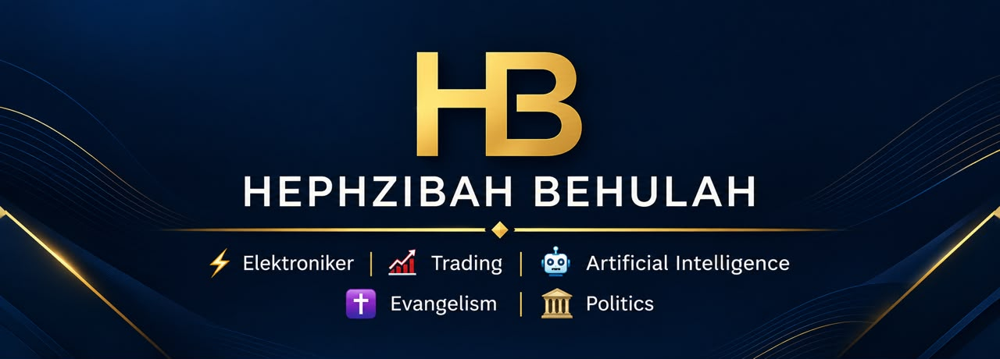
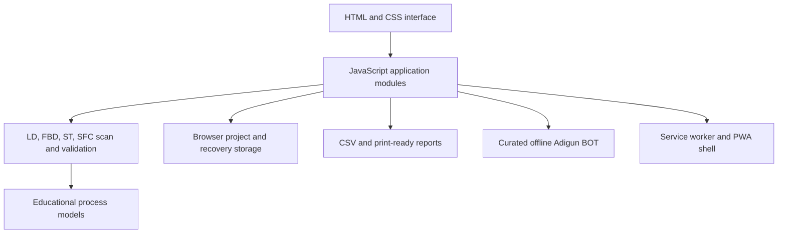

<p align="center">
  
</p>

<h1 align="center">AdigunSPs</h1>

<p align="center"><strong>By HB Elektroniker | A division of HEPHZIBAH BEHULAH</strong></p>

AdigunSPs is an offline-first, browser-based PLC programming learning and simulation application. It provides an editable ladder workspace, educational subsets of FBD, Structured Text and SFC, deterministic scan simulation, project validation, and local project tools for students, automation technicians, electrical engineers, and PLC programmers.

AdigunSPs is an educational simulator. It does not connect to physical PLC hardware and is not a certified safety or engineering system.

## Contents

- [Overview](#overview)
- [Features](#features)
- [Screenshots and preview](#screenshots-and-preview)
- [Technology and architecture](#technology-and-architecture)
- [Requirements](#requirements)
- [Run locally](#run-locally)
- [Build and tests](#build-and-tests)
- [Deployment](#deployment)
- [Security and safety](#security-and-safety)
- [Known limitations and future work](#known-limitations-and-future-work)
- [Contributing](#contributing)
- [License and ownership](#license-and-ownership)
- [Corporate links](#corporate-links)

## Overview

AdigunSPs offers a local workspace for learning PLC logic and exploring how supported programs behave over simulated scans. Projects are stored in the current browser profile. The application can be installed as a Progressive Web App (PWA) when served from localhost or HTTPS, and its cached shell supports offline use after it has been loaded.

The application is designed for learning and early logic exploration. It does not download programs to controllers, certify logic, select hardware, or replace a vendor programming environment.

## Features

### PLC editors and simulation

- **Ladder Diagram (LD):** edit series contacts and parallel branches; use NO, NC, rising-edge, and falling-edge contacts; and use normal, SET, and RESET coils. The simulator supports TON, TOF, and TP timers, CTU counters, and a linear SCALE instruction in the documented subset.
- **Function Block Diagram (FBD):** use Boolean logic, TON/TOF/TP timers, CTU, edge blocks, ADD/SUB/MUL/DIV, GT/LT/EQ, and SCALE. The validator reports supported missing-input, type, duplicate-output, and dependency-cycle errors.
- **Structured Text (ST):** compile and scan a subset with nested IF/ELSIF/ELSE, Boolean operators, numeric arithmetic and comparisons, MOD, and parentheses. Compilation uses a module worker when available and a synchronous fallback otherwise.
- **Sequential Function Chart (SFC):** edit steps, transitions, conditions, and actions in a Boolean sequential subset.
- **Scan controls:** run, pause, step, reset, view energized ladder paths, inject supported simulated I/O faults, set breakpoints, replay recorded inputs, and inspect bounded scan history.
- **Scenarios and examples:** run typed input sequences against expected outputs. The learning library contains 200 example projects with executable cases and generated generic PLC I/O schematics; these examples are educational material, not vendor-validated programs.
- **Electrical schematic workspace:** select generic PLCs and I/O modules, NO/NC controls and sensors, contactors and auxiliaries, overload contacts, breakers, fuses, lamps, solenoid coils, motors, supplies, terminals, junctions, and PE symbols. Place, move, rotate, duplicate, edit properties and I/O mappings, and connect terminals. Automatically generated references remain unique across component types that share a prefix. Saved diagrams are part of the project. A contactor's A1/A2 coil circuit drives its main and auxiliary contacts; a wired three-phase starter can switch the educational motor on/off model.
- **Electrical example checks:** each of the 200 examples includes a generic PLC schematic with mapped Boolean I/O and associated loads where applicable. Numeric tags use wired scalar analog source/module/indicator paths; values follow terminal connectivity through intermediate feed-through blocks, without modeling voltage or current. Shorted source poles are surfaced as simulation faults and do not energize connected loads. The generated report records 1,317 PLC logic cases, 903 independent Boolean schematic checks, and 1,317 integrated scenario cases through the wired input → PLC logic → connected output path where supported. Focused circuit tests also verify feed-through continuity, shorted analog nets, and distinct three-phase paths.

### Projects and engineering tools

- Create, open, rename, duplicate, save, autosave, import, and export browser-local projects; maintain recovery snapshots.
- Manage BOOL, INT, REAL, and TIME tags, roles, aliases, addresses, initial values, and simulated I/O.
- Convert supported simple LD networks to FBD with declared intermediate tags. PLCopen TC6 XML import/export is limited to simple series LD networks with NO/NC contacts and normal coils; unsupported constructs are rejected instead of silently discarded.
- Design multiple local HMI screens with simulated tag-bound controls, values, trends, alarms, recipes, and deterministic educational process models. The 2D process mimic is schematic, not engineering geometry.
- Export I/O schedules, user-entered hardware inventories/BOMs, trend history, and simulation reports as CSV or print-ready HTML that can be saved as PDF through the browser's print dialog. Wiring worksheets and panel references contain user-entered data; they do not determine ratings or certify a design.
- Use the offline Modbus TCP frame tool to inspect supported request/response frames and exceptions. It does not open a network connection or communicate with a PLC.
- Use Adigun BOT for curated, read-only explanations of supported PLC learning topics and the current local project. It is an offline helper, not a general AI model or engineering approval service.

### Interface and localization

- English, German, Yoruba, and Nigerian Pidgin interface content, examples, PWA metadata, and branding.
- System, light, and dark appearance settings.
- Responsive desktop and mobile layouts, keyboard commands, accessible logic outlines, and a local PWA shell.
- Parent/company identity uses the approved HEPHZIBAH BEHULAH logo; AdigunSPs remains the product wordmark and HB Elektroniker the division label.

## Screenshots and preview

Run the application locally to view the current interface. Screenshot files are not included in this repository yet; no mockup is presented as application evidence.

```powershell
npm run dev
```

Open [http://127.0.0.1:8080/](http://127.0.0.1:8080/). The local development server reloads the page when project files change.

## Technology and architecture

AdigunSPs uses browser-native HTML, CSS, and JavaScript ES modules without a frontend framework or third-party runtime dependencies. Node.js runs the local development server and build/test scripts. Projects use browser storage; the static application has no API server, account service, or cloud database.



The build synchronizes the four PWA manifests, syntax-checks JavaScript modules, and copies the static runtime files into `dist/`. Automated checks use Node.js assertions and deterministic simulator cases.

## Requirements

### Required

- A modern browser with JavaScript ES modules, IndexedDB, and service worker support for installable/offline behavior.
- Node.js to run the development server, build, and automated checks. The current scripts were verified with Node.js 24.13.1; `package.json` does not currently declare an `engines` range.
- A local device/browser profile for project storage. No PLC, backend, API key, or external account is required for the implemented local features.

### Recommended

- Serve the app on localhost during development or on HTTPS when installing the PWA. Opening `index.html` directly does not enable service-worker installation.
- Use a desktop browser for the full editor; the responsive layout provides a compact mobile workspace.

The repository does not define a minimum memory, CPU, operating-system, or browser-version matrix. Those compatibility ranges have not been independently qualified.

## Run locally

The development server and test/build scripts have no npm package dependencies, so an install step is not required.

```powershell
git clone https://github.com/HephzibahBehulahHQ/AdigunSPs.git
cd AdigunSPs
npm run dev
```

Visit [http://127.0.0.1:8080/](http://127.0.0.1:8080/). To use a different port in PowerShell:

```powershell
$env:ADIGUN_DEV_PORT = "8081"
npm run dev
```

Then open `http://127.0.0.1:8081/`. The only supported environment setting is `ADIGUN_DEV_PORT`; no `.env` file or backend configuration is needed.

## Build and tests

Create the static production bundle:

```powershell
npm run build
```

This generates the localized manifests, checks JavaScript syntax, and writes the deployable files to `dist/`.

Run the complete local automated suite:

```powershell
npm test
```

The suite covers 200 learning examples and their deterministic PLC and generic electrical behavior cases, plus focused branding, hardware/report, Adigun BOT, resource, and Modbus TCP checks. The per-example report in [`docs/engineering-validation-report.json`](docs/engineering-validation-report.json) records 1,317 logic cases, 903 independent Boolean schematic checks, and 1,317 integrated PLC-to-component cases; all passed in the current run. Focused electrical tests check terminal continuity, contactor coil paths, supply shorts, distinct three-phase paths, analog signal routing through terminals, mappings, and saved diagram round-trips. Electrical components are generic educational models: manufacturer compatibility, detailed electrical physics, analog voltage/current physics, safety functions, and physical wiring are not validated. There are no separate lint, TypeScript, or browser E2E scripts configured. Full browser interaction, accessibility, security, performance, cross-browser, and PWA installation audits remain outstanding.

Run `npm run validate:examples` to regenerate the report from the simulator checks.

Focused suites are available as `npm run test:electrical`, `npm run test:brand`, `npm run test:hardware`, `npm run test:ai`, `npm run test:resources`, and `npm run test:protocol`.

## Deployment

The built application is a static web bundle. Publish the contents of `dist/` to an HTTPS static host; keep `service-worker.js` at the same path as `index.html` and serve JavaScript modules and web manifests with appropriate MIME types. Increment the service-worker cache version when releasing shell changes.

No production hosting provider, CI/CD workflow, backend service, or public application URL is configured in this repository. The GitHub repository is source code hosting, not a deployed application URL. The application currently stores projects in each browser and has no shared or server-side data service.

## Security and safety

- Projects and recovery snapshots stay in the browser profile. Exported project files may contain user-created logic, tags, and project metadata; store and share them accordingly.
- Imported projects are handled as application data and checked against the supported project model. Do not import files from sources you do not trust.
- The implemented Adigun BOT helper is read-only and offline. It does not send project data to an AI provider and does not generate or approve PLC programs.
- The simulator does not connect to physical hardware, execute real I/O, validate a safety function, or establish standards compliance.
- Independently review and validate all engineering work using the target vendor tools and approved safety processes before any physical industrial use.

No safety certification, functional-safety compliance, supported vendor/controller catalog, or physical communication is claimed.

## Known limitations and future work

The following areas are incomplete or require stakeholder decisions before they can be responsibly implemented:

- Full IEC conformance, complete POU/task interchange, schema validation, vendor import compatibility, device catalogs, downloads, and hardware-in-the-loop require target vendors, CPUs, dialects, and test equipment.
- Physical connectivity and OPC UA, Modbus RTU, MQTT, REST/WebSocket, SQL, or historian services require approved endpoints, protocols, and security requirements. The current Modbus tool is a local frame simulator only.
- Cloud sync, collaboration, SSO/RBAC, centralized backup, administration, licensing, and disaster recovery require a backend, identity, hosting, data residency, and retention decisions.
- General model-backed AI, provider routing, voice, screenshot input, and AI policy controls require an approved provider, privacy notice, and retention policy. Current Adigun BOT behavior is a limited offline helper.
- Classroom assignments, grading, certificates, sharing, e-signatures, and formal approval records require education and legal/quality policies.
- Complete human translation review, larger-project browser performance, keyboard/screen-reader audits, security review, and cross-browser/PWA installation QA remain to be completed.
- The process models are deterministic educational examples, not validated operating envelopes or an engineering digital twin. Hardware inventory fields are user-entered and do not verify equipment suitability or ratings.

See [requirements status](docs/requirements-status.md), [stakeholder inputs](docs/stakeholder-inputs.md), and [verification record](docs/verification.md) for current detail and decisions needed.

## Troubleshooting

| Issue | Check |
|---|---|
| Port 8080 is already in use | Set `ADIGUN_DEV_PORT` to another local port and restart `npm run dev`. |
| PWA install or offline mode is unavailable | Use localhost or HTTPS rather than opening the file directly; load the app once while online so the service worker can cache its shell. |
| A project is missing on another device/browser | Projects are local to the current browser profile. Export a project JSON file to move a copy between profiles. |
| A project feature or instruction is rejected | The editors support documented subsets. Run the project checks and remove or replace unsupported constructs; vendor-specific compatibility is not provided. |
| A report should be a PDF | Use the browser's print dialog on the print-ready report and choose its PDF output option. |

## Contributing

No public contribution or issue-triage policy has been published yet. Access to the repository is controlled by the organization. Coordinate with an authorized maintainer before proposing changes. Changes should preserve the local project format and safety boundary, follow the shared HEPHZIBAH BEHULAH design system, keep product and company identities separate, and include relevant tests and documentation.

## License and ownership

AdigunSPs is a product of HEPHZIBAH BEHULAH, developed under the HB Elektroniker division. No software license or redistribution terms have been provided. The absence of a license does not grant permission to reuse or redistribute this source. No `LICENSE` file is included.

## Corporate links

- [HEPHZIBAH BEHULAH corporate website](https://hephzibahbehulah.com/)
- [HEPHZIBAH BEHULAH GitHub organization](https://github.com/HephzibahBehulahHQ)
- [HB Elektroniker division](https://github.com/HephzibahBehulahHQ/hb-elektroniker)
- [HB design system](https://github.com/HephzibahBehulahHQ/hb-design-system)
- [AdigunSPs source repository](https://github.com/HephzibahBehulahHQ/AdigunSPs)
- [Facebook](https://www.facebook.com/Hephzibahbehulah/)
- [X](https://x.com/HephzibaBehulah)
- [Instagram](https://www.instagram.com/hephzibahbehulah/)
- [TikTok](https://www.tiktok.com/@hephzibahbhehulah)
- [LinkedIn personal profile](https://www.linkedin.com/in/isaacoluwoleadigun/)

**AdigunSPs — a product of HEPHZIBAH BEHULAH.**
